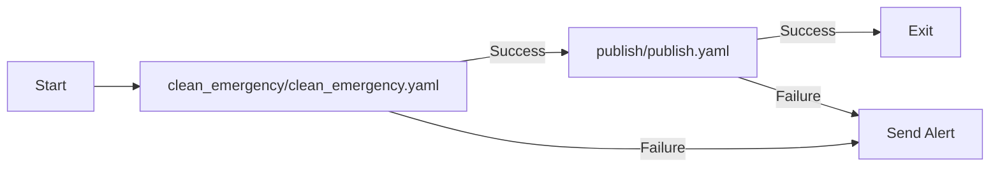
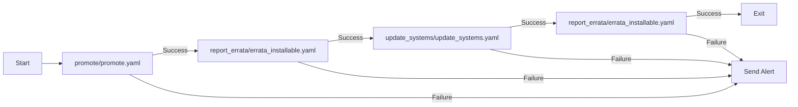
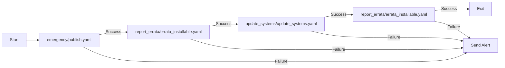
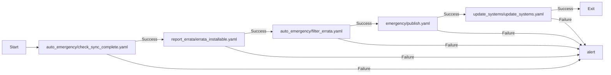

## Publishing (AAP Job: Publish Content Views)

## Update Systems (AAP Job: Patch Cycle)

## Emergency Publish (AAP Job: Emergency Publish)

## Automatic Emergency CVE processing (AAP Job: Process Errata)
