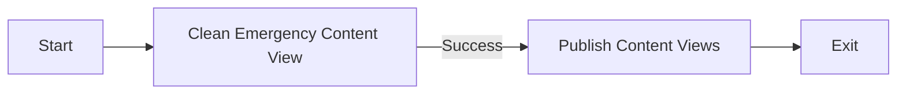
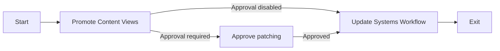
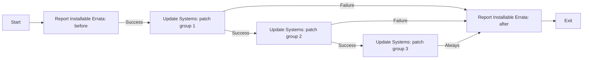
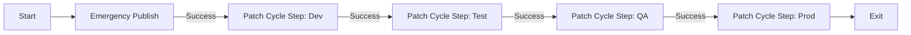
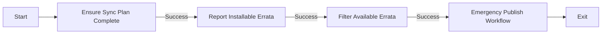

# Workflows

These are the AAP workflow job templates defined in `aap_config/workflow_job_templates.yml`. Names below use the default `Satellite - ` prefix. Workflow failures invoke the configured **Satellite - Workflow Failure** notification where one is attached; that notification is not a workflow node.

## Publish Content Views Workflow
Runs **Clean Emergency Content View**, then **Publish Content Views**. The cleanup job removes the emergency errata rules and publishes a cleared emergency content view when its rule lookup succeeds.

## Patch Cycle Step Workflow
Promotes the selected content views into the chosen lifecycle environment, then optionally waits for approval before calling **Update Systems Workflow**. The approval node is present when `sat_require_patch_approval` is true; it is enabled by default.

## Update Systems Workflow
Reports installable errata before patching, then runs **Update Systems** once per configured patch group, in order. A successful group advances to the next group. A failed group routes to the closing report; the final group always routes there. The closing report is informational and is not a success prerequisite for the patch run.

The diagram shows the default three patch groups. The group sequence is generated from `sat_patch_groups`.

## Emergency Publish Workflow
Runs **Emergency Publish**, then invokes **Patch Cycle Step Workflow** for each configured lifecycle environment in order. Each step promotes the emergency content through that environment and runs the normal update workflow; the approval behavior comes from the nested Patch Cycle Step workflow.

The lifecycle stages shown are the defaults in `aap_config/defaults.yml`; the workflow builds this chain from `sat_lifecycle_environments`.

## Process Errata Workflow
Checks that no repository sync is currently running, reports available errata across all hosts in Library, filters the results, then launches **Emergency Publish Workflow** with all-host scope and Library as the starting lifecycle environment.

