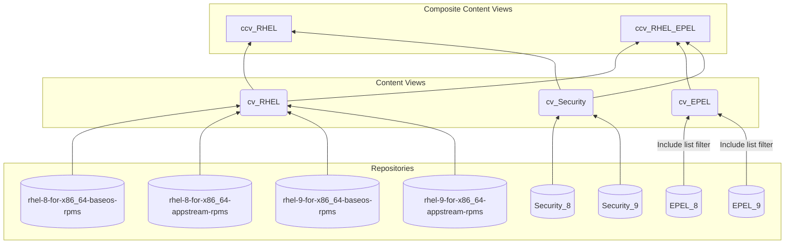

# Content Views

Content Views are used to filter your repositories as well as freeze them at specific dates so you can ensure that the updates you applied to your test machines are the same updates that you will be applying your production machines regardless of what commands are run.

## Building block design
The easiest way to automate the management of the content views is to treat them as building blocks. Each content view serves a specific piece of a purpose and then the composite content views can combine them to get to the final result. This way each level only has a dependency on the levels below it and there are no intra-level dependencies.

Once the structure has been built, machines should only be assigned to a composite content view. The component content views should only be used to supply packages to the next level. If this is followed, you do not need to promote the component content views beyond Library as the lifecycle step will not be relevant.

## Auto publish (Composite Content Views)
Auto publish will allow the Satellite server to automatically publish a composite content view if any of the component content views are published. If you are planning to publish multiple component content views as the same time (as this method describes), it is not recommended to enable auto publish as it will result in multiple wasted versions of each composite content view being created. In this situation, it is a waste of database storage and cpu time.

## Solve dependencies (Content Views)
Solve dependencies allows the Satellite server to automatically add in any dependent packages as it is publishing a new version of the content view. Unless you are filtering the content view, it is recommended to leave this option turned off as it will cause the publishing process to take longer.

### Descriptive Example
| Name                 | Composite | Description                                                                                                 |
| -------------------- | --------- | ----------------------------------------------------------------------------------------------------------- |
| cv_RHEL              | false     | This will contain the base operating system that all systems will share (BaseOS & AppStream repositories).  |
| cv_EPEL              | false     | This will contain the EPEL repositories. Due to some previous conflicting packages, it is recommended to create an include filter and only add in the packages you require. Solve Dependencies can be enabled so you do not need to list all dependent packages as well.    |
| cv_Security          | false     | This will contain the repositories for your security tools (Microsoft Defender, Rapid7, etc). As they may require updates that won't necessarily line up with your normal patching schedule, it is good to keep them separate.                                             |
| cv_Emergency         | false     | This will contain patches that need to be installed immediately and outside your normal patching schedule. A filter should be created restrict the packages to specific RHSAs. It can then be added to composite content views as needed and reset after each normal patch window |
| cv_SAP_Applications  | false     | This is for repositories related to the SAP Applications repository. Keeping the systems attached to a separate content view prevents someone from using packages from a repository that requires an additional subscription.                                            |
| cv_SAP_Solutions     | false     | This is for repositories related to the SAP Solutions repository. Keeping the systems attached to a separate content view prevents someone from using packages from a repository that requires an additional subscription.                                                 |
| ccv_RHEL             | true      | This is a composite content view that will combine cv_RHEL and cv_Security. It can also include cv_Emergency when necessary |
| ccv_RHEL_EPEL        | true      | This is a composite content view that will combine cv_RHEL, cv_EPEL, and cv_Security. It can also include cv_Emergency when necessary |
| ccv_SAP_Applications | true      | This is a composite content view that will combine cv_SAP_Applications and cv_Security. It can also include cv_Emergency when necessary |
| ccv_SAP_Solutions    | true      | This is a composite content view that will combine cv_SAP_Applications and cv_Security. It can also include cv_Emergency when necessary |

### Visual Example
