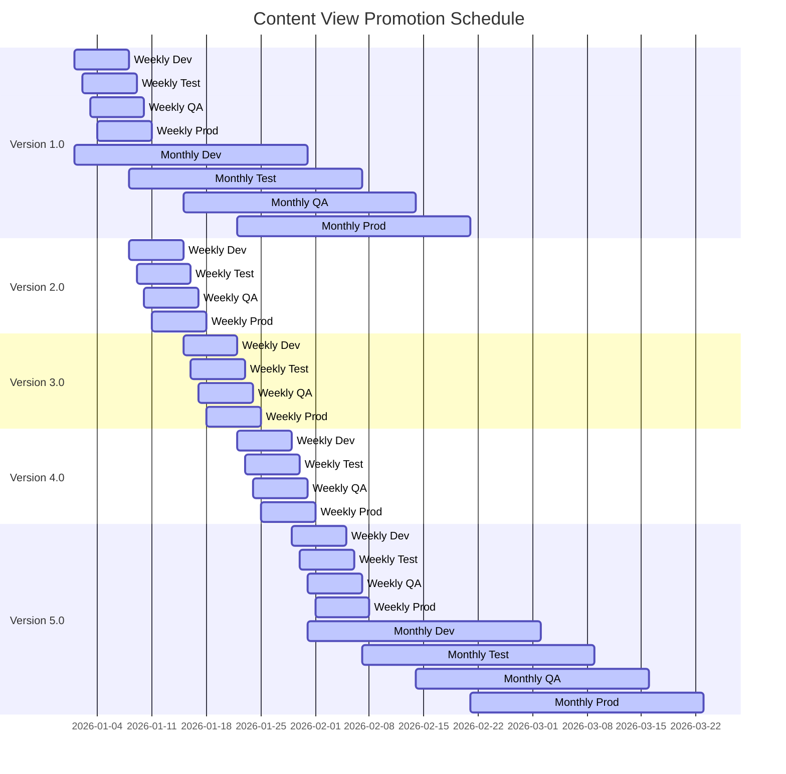

# Lifecycle Environments

Lifecycle environments should, for the most part, be a single path. Everyone typically has their variation of `Dev -> Test -> QA -> Prod`. That should be created as a single path.

## Multiple patching schedules
If you have multiple patching schedules (ex: weekly and monthly) for different sets of machines that is where you should use multiple lifecycle paths. This will allow you to reuse the same content view with one of the lifecycle paths skipping over some of the versions.

Example:
```
Version 1.0 = Month 1 Week 1
Version 2.0 = Month 1 Week 2
Version 3.0 = Month 1 Week 3
Version 4.0 = Month 1 Week 4
Version 5.0 = Month 2 Week 1
```
